# پنل فایل بله 🎈

[](https://www.php.net/)
[](https://www.mysql.com/)
[](https://docs.bale.ai/)
[]()
[](LICENSE)

سلام! 👋

خب، بذار خودمونی بگم: این یه پنل وب فارسی و خوشگله که فایل‌هات رو روی **سرورهای بله** ذخیره می‌کنه —
همون‌جایی که تا **۵ گیگابایت** فضا داری و هیچ‌وقت هارت نمی‌خوری! 😄

ایده ساده‌ست: فایل رو آپلود می‌کنی، ربات بله خودش می‌برتش توی چت اختصاصی‌ات، و پنل بهت پیش‌نمایش،
پوشه‌بندی، لینک اشتراک‌گذاری و کلی امکانات دیگه می‌ده. روی سرور خودت هم فقط چند خط متادیتا توی MySQL
می‌شینه؛ یعنی عملاً **هیچ هاردی خرج ذخیرهٔ فایل‌ها نمی‌شه!** 🤯

#بله #بات_بله #ذخیره_سازی_ابری #مدیریت_فایل #پی_اچ_پی #متن_باز #فارسی_راست_چین
#Bale #BaleBot #CloudStorage #FilePanel #PHP #MySQL #OpenSource #PersianRTL

---

## 📸 یه نگاه بنداز

**سمت کاربر:**

| | |
|---|---|
| 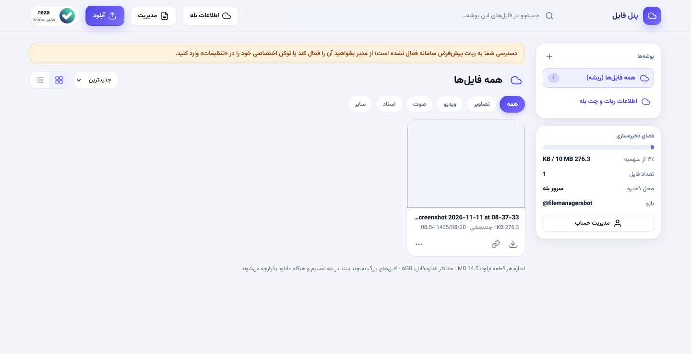 | 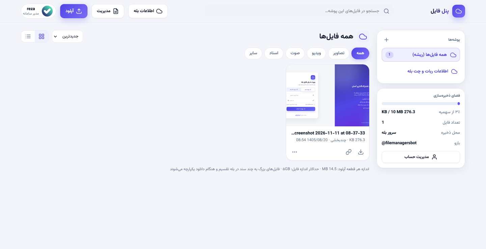 |
| **پنل فایل‌ها (نمای لیستی)** | **نمای کارتی با پیش‌نمایش** |
| 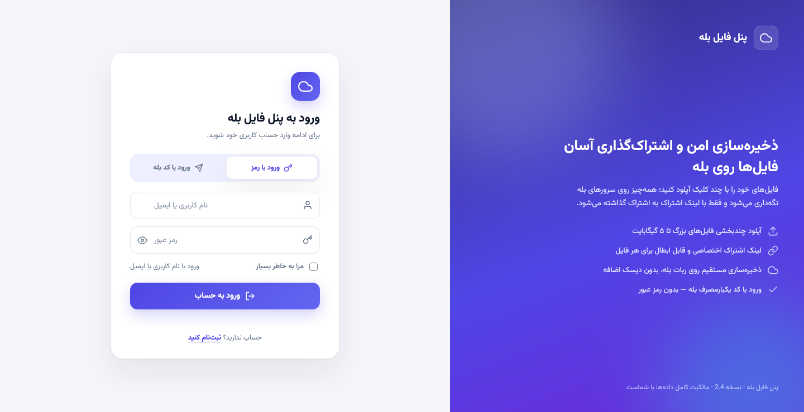 | 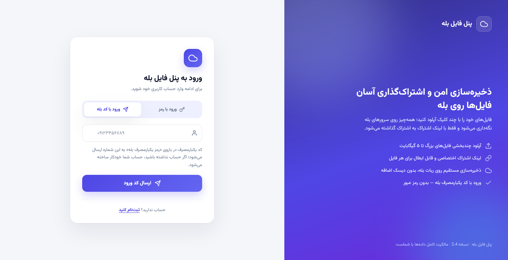 |
| **صفحهٔ ورود با رمز** | **ورود با شمارهٔ بله** |
| 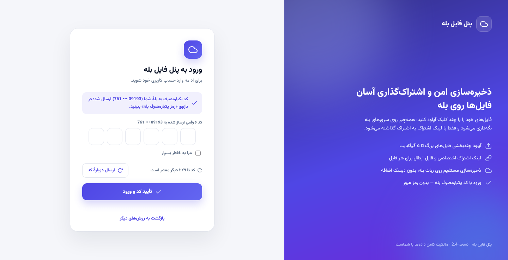 | 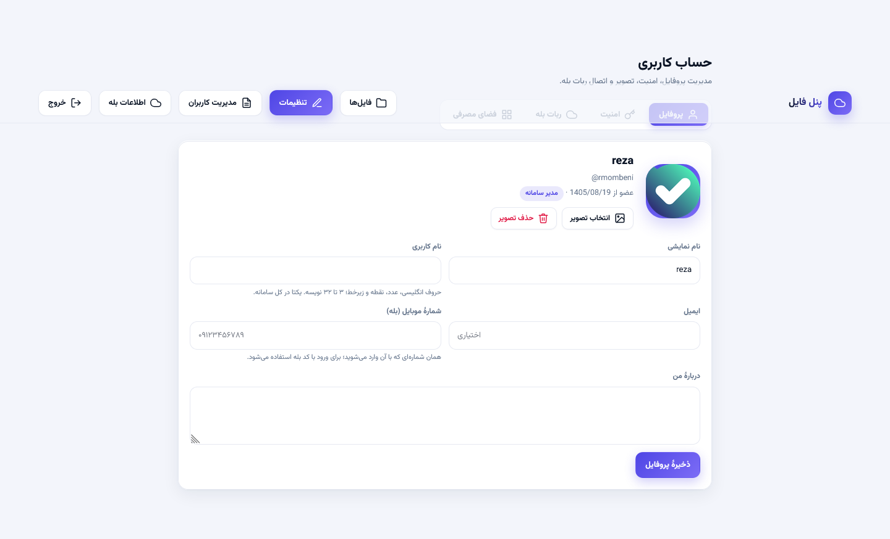 |
| **جعبه‌های کد یکبارمصرف** | **پروفایل و آواتار** |
| 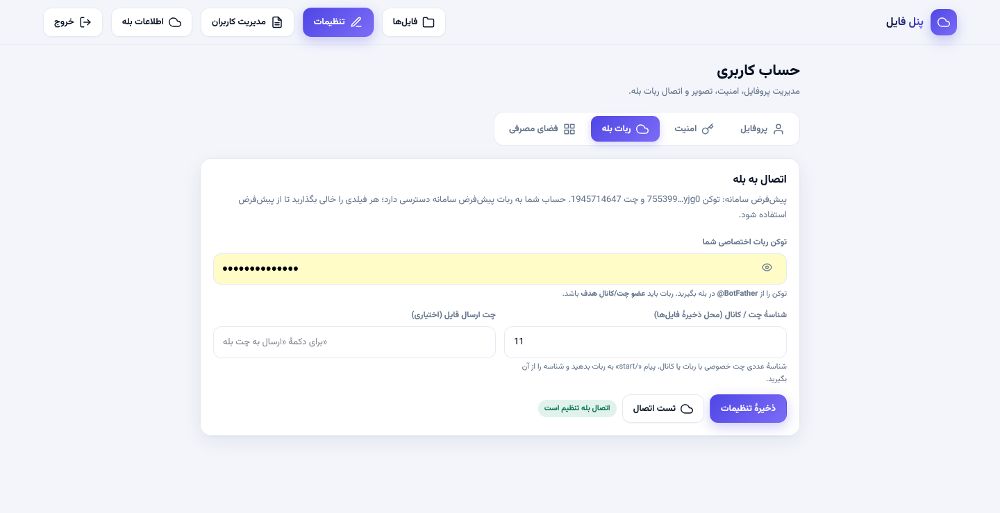 | 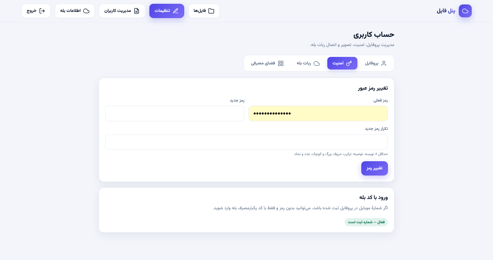 |
| **ربات اختصاصی هر کاربر** | **امنیت و تغییر رمز** |
| 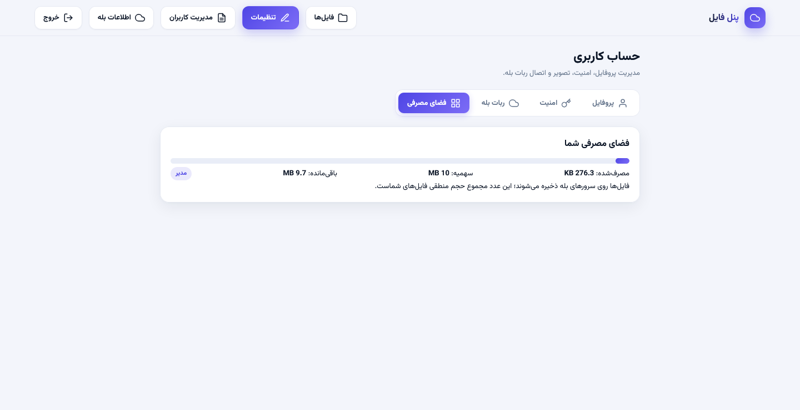 | 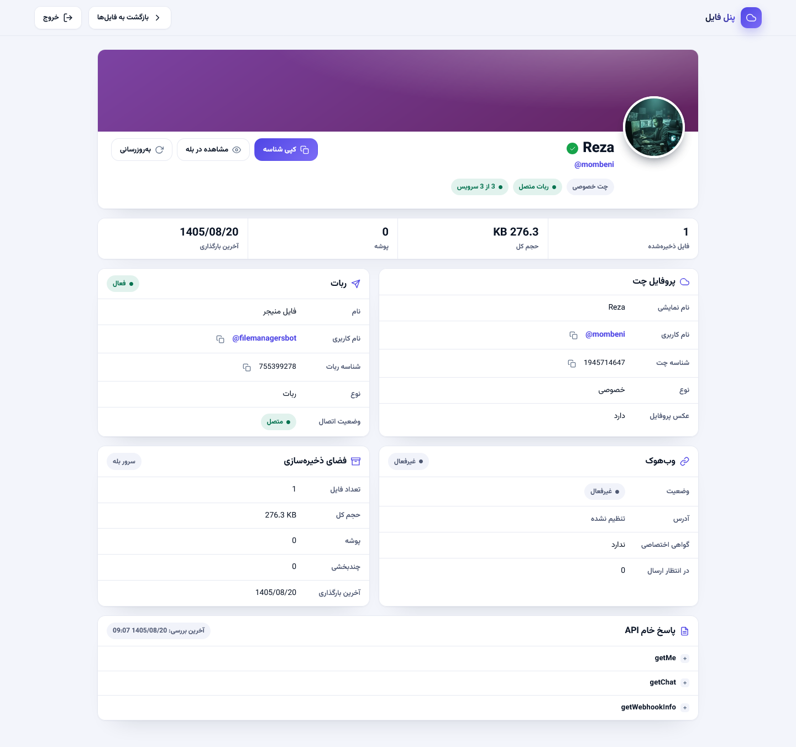 |
| **متر فضای مصرفی** | **وضعیت اتصال به بله** |

**سمت مدیر:**

| | |
|---|---|
| 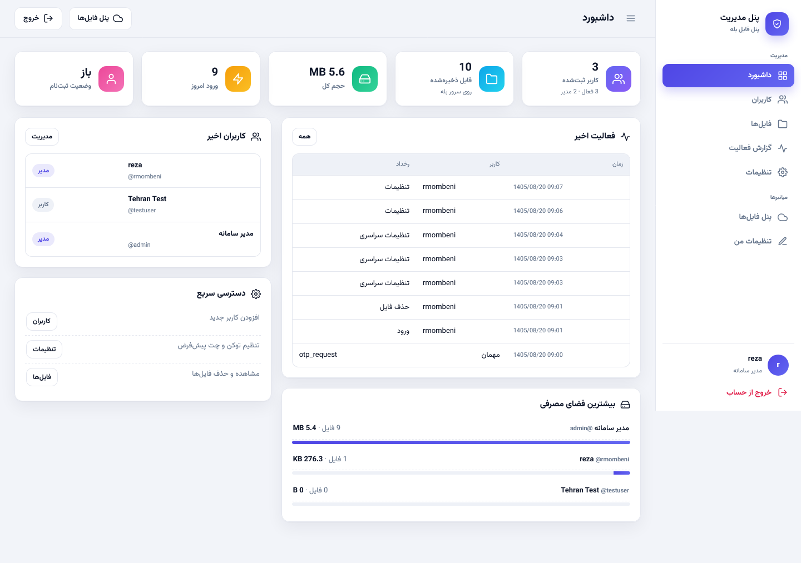 | 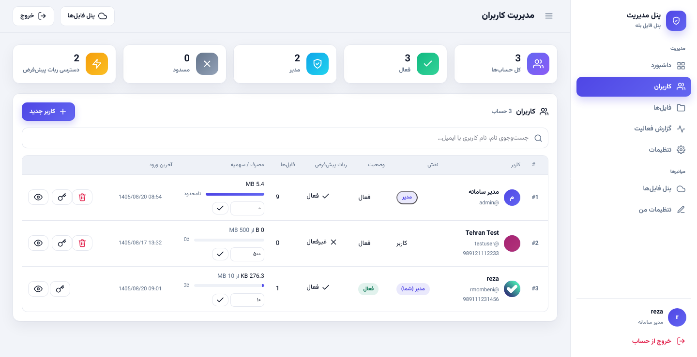 |
| **داشبورد مدیریت** | **مدیریت کاربران** |
| 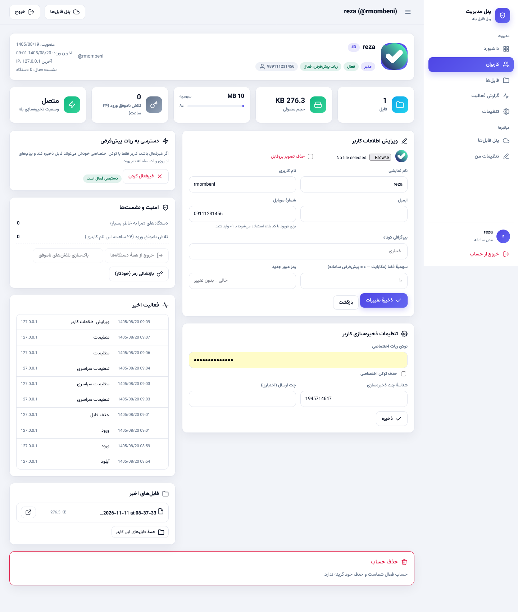 | 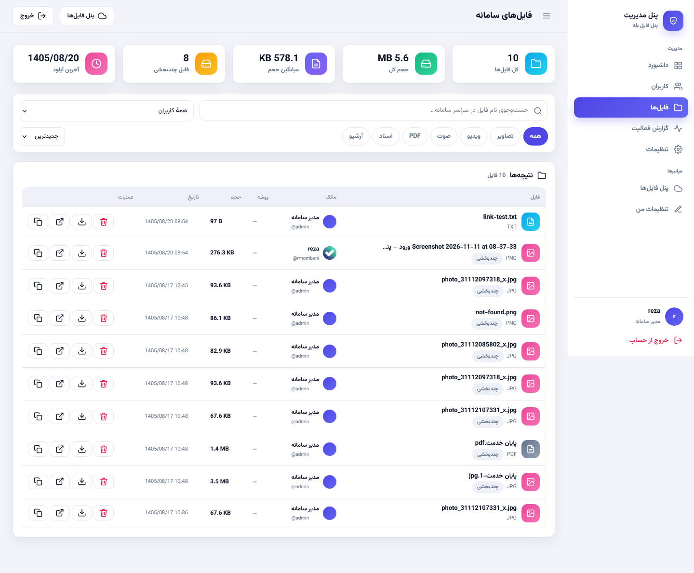 |
| **جزئیات و تنظیمات هر کاربر** | **فایل‌های همهٔ کاربران** |
| 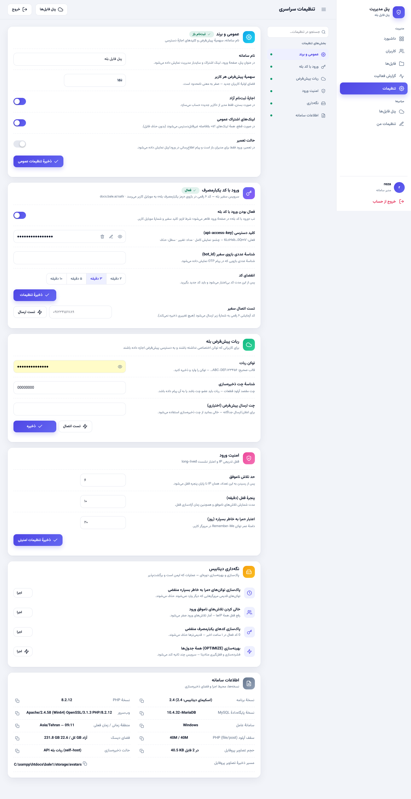 | 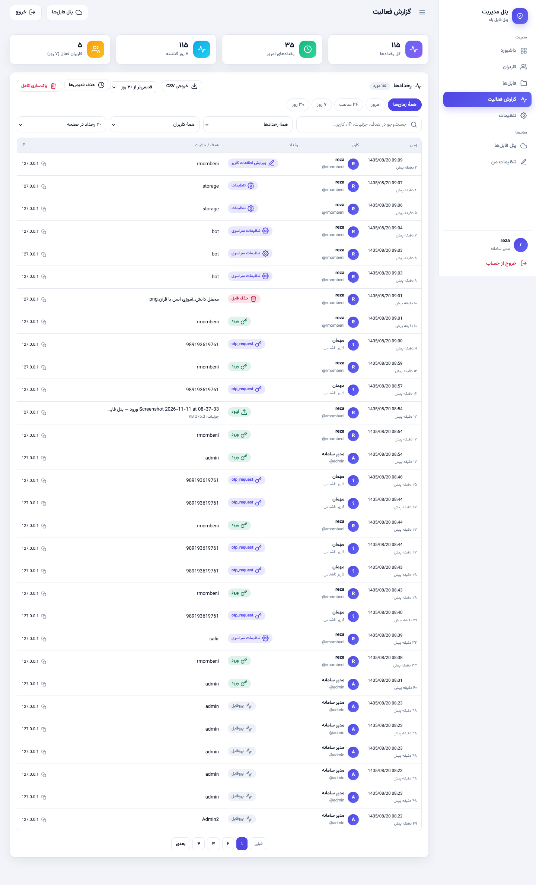 |
| **تنظیمات سامانه** | **گزارش کامل فعالیت‌ها** |

---

## فهرست

- [ویژگی‌ها](#ویژگیها)
- [نصب سریع](#نصب-سریع)
- [نصب دستی](#نصب-دستی)
- [پیکربندی](#پیکربندی)
- [آپلود فایل‌های بزرگ](#آپلود-فایلهای-بزرگ)
- [لینک‌های اشتراک و پیام لینک در بله](#لینکهای-اشتراک-و-پیام-لینک-در-بله)
- [ورود با کد بله (OTP)](#ورود-با-کد-بله-otp)
- [پنل مدیریت](#پنل-مدیریت)
- [ساختار پروژه](#ساختار-پروژه)
- [امنیت](#امنیت)
- [عیب‌یابی](#عیبیابی)

---

## ✨ ویژگی‌ها

**ذخیره‌سازی و فایل‌ها**
- آپلود تک‌درخواستی تا ۵۰ مگابایت و آپلود **چندبخشی تا ۵ گیگابایت** (قطعات ۱۵ مگابایتی؛ هر قطعه جداگانه در بله ذخیره و هنگام دانلود یکپارچه می‌شود)
- پوشه‌بندی، تغییر نام، انتقال، حذف، جست‌وجوی زنده و دسته‌بندی خودکار (تصویر/ویدیو/صوت/سند/آرشیو)
- نمای کارتی و لیستی، مرتب‌سازی بر اساس نام/حجم/تاریخ، اعداد و تاریخ شمسی
- پیش‌نمایش داخلی تصاویر، ویدیو، صوت، PDF و متن (با صفحه‌گرد و ناوبری بین فایل‌ها)
- **لینک اشتراک‌گذاری عمومی** برای هر فایل با قابلیت ابطال و ساخت لینک جدید
- **پیام لینک در بله:** بعد از هر آپلود، پیامی حاوی نام/حجم/تاریخ/لینک اشتراک و لینک دانلود مستقیم همراه دو دکمهٔ Inline («دانلود مستقیم» و «مشاهده در پنل») در چت ربات ارسال می‌شود
- ارسال فایل (یا قطعات فایل بزرگ) به چت شخصی کاربر در بله از داخل پنل

**حساب کاربری**
- ورود کلاسیک با رمز + «مرا به خاطر بسپار» (کوکی امن ۳۰ روزه با توکن یک‌بارمصرف)
- **ورود با کد یکبارمصرف بله** (پیامک ابری سفیر) با کد هش‌شده، تایمر انقضا و قفل ارسال مجدد
- ثبت‌نام خودکار با شمارهٔ بله + صفحهٔ تکمیل اطلاعات اجباری پس از اولین ورود
- پروفایل کامل: آواتار، نام، نام کاربری، ایمیل، شمارهٔ موبایل، «دربارهٔ من»
- توکن ربات اختصاصی برای هر کاربر + شناسهٔ چت ذخیره‌سازی و چت ارسال، با **دکمهٔ تست اتصال**
- سهمیهٔ فضای اختصاصی برای هر کاربر با متر مصرف

**رابط کاربری**
- طراحی مدرن شیشه‌ای با دارک‌مود خودکار، کاملاً ریسپانسیو و راست‌چین
- فونت وزیرمتن به‌صورت لوکال (بدون وابستگی به CDN)
- صفحهٔ ورود دوستونه با پنل برند، جعبه‌های مجزای کد OTP، نمایش قدرت رمز

## 🚀 نصب سریع

راستش نصبش خیلی راحته! فقط چند دقیقه وقت می‌بره:

پیش‌نیازها: **PHP >= 8.0** با افزونه‌های `pdo_mysql`، `curl`، `mbstring`، `fileinfo`، `json`
(اختیاری: `intl` برای تاریخ شمسی دقیق‌تر، `gd`) و **MySQL/MariaDB**. روی XAMPP همهٔ این‌ها موجود است.

1. پوشهٔ پروژه را داخل وب‌روت کپی کنید (مثلاً `C:\xampp\htdocs\bale1` یا `/var/www/html/bale1`).
2. در مرورگر `http://localhost/bale1/install.php` را باز کنید.
3. نصاب چهار مرحله دارد:
   - **پیش‌نیازها:** بررسی نسخهٔ PHP، افزونه‌ها و قابل‌نوشتن بودن مسیرها
   - **دیتابیس:** مشخصات MySQL؛ دیتابیس در صورت نبود خودکار ساخته و `config.php` تولید می‌شود (نسخهٔ قبلی با پسوند `.bak` ذخیره می‌شود)
   - **حساب مدیر:** نام کاربری، نام نمایشی و رمز مدیر اصلی
   - **پایان:** نصاب با `storage/install.lock` قفل می‌شود و دیگر اجرا نمی‌شود
4. وارد `http://localhost/bale1/` شوید و از «حساب کاربری ← تب ربات بله» توکن ربات و شناسهٔ چت را تنظیم کنید.

> برای نصب مجدد، فایل `storage/install.lock` را حذف کنید. توصیهٔ امنیتی: پس از نصب، `install.php` را از سرور حذف کنید.

## 🔧 نصب دستی

اگر حال‌وحال نصاب نداری، دستی هم می‌شه:

1. `config.example.php` را به `config.php` تغییر نام بده و مشخصات دیتابیس و توکن پیش‌فرض ربات را وارد کن.
2. مطمئن شو پوشهٔ `storage/` برای PHP قابل‌نوشتن است (در لینوکس: `chmod 770 storage`).
3. اولین اجرای برنامه اسکیمای دیتابیس را به‌صورت خودکار می‌سازد (`storage/.installed` نشانگر نصب است).
   حساب مدیر اولیه با نام کاربری `admin` و رمز `ADMIN_PASSWORD_SEED` ساخته می‌شود — بلافاصله آن را عوض کن!

### اجرای آپلود چندبخشی

برای فایل‌های بزرگ این دو مقدار در `php.ini` را افزایش دهید (پیشنهادی):

```ini
upload_max_filesize = 64M
post_max_size = 64M
```

اندازهٔ هر قطعه آپلود برابر `upload_max_filesize` واقعی تشخیص داده می‌شود و در پنل نمایش داده می‌شود.

## ⚙️ پیکربندی

همهٔ ثابت‌ها در `config.php` هستند (نصاب همان را می‌سازد):

| ثابت | توضیح |
|---|---|
| `DB_HOST` / `DB_PORT` / `DB_NAME` / `DB_USER` / `DB_PASS` | مشخصات اتصال MySQL |
| `APP_TITLE` / `APP_VERSION` | عنوان و نسخهٔ سامانه |
| `STORAGE_DIR` | مسیر ذخیرهٔ فایل‌های لوکال (آواتارها و وضعیت آپلود چندبخشی) |
| `BOT_TOKEN_DEFAULT` | توکن پیش‌فرض ربات بله (`@BotFather`) |
| `CHAT_ID_DEFAULT` | شناسهٔ چت/کانال پیش‌فرض محل ذخیرهٔ فایل‌ها |
| `SEND_TO_CHAT_DEFAULT` | چت پیش‌فرض «ارسال به چت بله» |
| `ADMIN_PASSWORD_SEED` | رمز اولیهٔ حساب `admin` (فقط نصب دستی) |
| `MAX_UP` | سقف آپلود تک‌درخواستی (پیش‌فرض ۵۰MB) |
| `MAX_CHUNK` | اندازهٔ هر قطعهٔ آپلود چندبخشی (پیش‌فرض ۱۵MB) |
| `MAX_LOGICAL_UPLOAD` | سقف منطقی هر فایل (پیش‌فرض ۵GB) |
| `MAX_LOGIN_FAILS` / `LOGIN_WINDOW` | قفل موقت پس از تلاش‌های ناموفق ورود |
| `REMEMBER_DAYS` | عمر کوکی «مرا به خاطر بسپار» |

**راه‌اندازی ربات بله:** با `@BotFather` در بله یک بازو بسازید و توکن بگیرید؛ ربات باید **عضو چت/کانال هدف**
باشد. شناسهٔ عددی چت را از ربات بگیرید (یا با `getChat`). همهٔ این‌ها برای هر کاربر هم از «حساب کاربری ←
ربات بله» قابل تنظیم است و مدیر می‌تواند از پنل مدیریت دسترسی کاربران به ربات پیش‌فرض سامانه را کنترل کند.

## 📦 آپلود فایل‌های بزرگ

این‌جاش خیلی باحاله: فایل ۵ گیگی هم می‌شه آپلود کرد!

- فایل‌های بزرگ‌تر از `MAX_UP` به‌صورت **چندبخشی** آپلود می‌شوند: مرورگر فایل را به قطعات هم‌اندازه تقسیم
  می‌کند، هر قطعه با `sendDocument` در بله ذخیره و `file_id` آن در جدول وضعیت آپلود ثبت می‌شود.
- پس از رسیدن آخرین قطعه، رکورد نهایی فایل ساخته می‌شود؛ هنگام دانلود، قطعات به‌ترتیب از بله دریافت و
  به‌صورت استریم یکپارچه به کاربر تحویل می‌شوند.
- فایل‌های بزرگ‌تر از `MAX_DL` (۲۰ مگابایت) پیش‌نمایش مستقیم ندارند اما لینک دانلود یکپارچه‌شان کار می‌کند.
- در صورت قطع‌شدن وسط آپلود، وضعیت در `storage/upload-states/` می‌ماند و ادامه از همان‌جا ممکن است؛
  وضعیت‌های ناتمام قدیمی خودکار پاک می‌شوند.

## 🔗 لینک‌های اشتراک و پیام لینک در بله

- هر فایل یک شناسهٔ اشتراک تصادفی دارد: `?s=<token>` — صفحهٔ عمومی با پیش‌نمایش و دکمهٔ دانلود.
- با گزینهٔ «لینک جدید» لینک قبلی باطل و لینک تازه ساخته می‌شود.
- پس از هر آپلود موفق، پیام لینک با فرمت HTML و دکمه‌های Inline در چت ذخیره‌سازی (و چت ارسال در صورت
  تنظیم) ارسال می‌شود؛ برای فایل‌های چندبخشی تعداد قطعات هم ذکر می‌شود.
- امکان ارسال مستقیم فایل از پنل به چت شخصی کاربر در بله («ارسال به چت بله»).

## 🔢 ورود با کد بله (OTP)

1. کاربر شمارهٔ موبایل خود را وارد می‌کند؛ کد ۶ رقمی از طریق سرویس پیامک ابری **سفیر** در بازوی
   «رمز یکبارمصرف بله» ارسال می‌شود.
2. کد به‌صورت هش SHA-256 با زمان انقضا (`otp_ttl`، پیش‌فرض ۳۰۰ ثانیه) ذخیره می‌شود؛ حداقل فاصلهٔ ارسال
   ۶۰ ثانیه و تعداد تلاش ناموفق محدود است.
3. اگر شماره در سامانه نباشد (در صورت فعال بودن «ثبت‌نام آزاد») حساب جدید به‌صورت خودکار ساخته و کاربر
   برای تکمیل پروفایل هدایت می‌شود.
4. شمارهٔ موبایل در کل سامانه یکتاست (`uq_phone`) تا ورود همیشه به یک حساب برسد.

در حالت تعمیر، ورود کاربران عادی و لینک‌های اشتراک بسته می‌شود و فقط مدیران می‌توانند وارد شوند.

## 🛠 پنل مدیریت

`admin/` با ورود جداگانه (فقط نقش مدیر):

- **کاربران:** ساخت/ویرایش/غیرفعال‌سازی، نقش، سهمیهٔ فضای اختصاصی، تنظیم توکن و چت‌های هر کاربر، آواتار
- **تنظیمات:** توکن/چت پیش‌فرض سامانه، کلید سفیر، ثبت‌نام آزاد، حالت تعمیر، مدت اعتبار کد OTP،
  دسترسی کاربران به ربات پیش‌فرض، سقف‌های آپلود، آمار دیسک
- **گزارش فعالیت:** لاگ کامل رخدادها (ورود، آپلود، حذف، تنظیمات و…) با فیلتر جست‌وجو، بازهٔ زمانی،
  خروجی CSV، پاک‌سازی خودکار لاگ‌های قدیمی و مودال جزئیات
- **فایل‌ها:** مشاهده و مدیریت فایل‌های همهٔ کاربران

## 📂 ساختار پروژه

```text
bale1/
├── install.php          # نصاب وب چهارمرحله‌ای (بعد از نصب قفل می‌شود)
├── config.example.php   # نمونهٔ پیکربندی (به config.php تغییر نام بده)
├── config.php           # ثابت‌های پیکربندی (توسط نصاب تولید می‌شود)
├── index.php            # هسته: پنل فایل، آپلود، دانلود، لینک اشتراک، CSS/JS
├── bale.php             # صفحهٔ اطلاعات ربات و چت بله (getMe/getChat و…)
├── admin/
│   ├── bootstrap.php    # احراز هویت مدیر، توابع مشترک ادمین
│   ├── users.php        # مدیریت کاربران
│   ├── user.php         # ویرایش یک کاربر
│   ├── settings.php     # تنظیمات سامانه
│   ├── logs.php         # گزارش فعالیت (فیلتر/CSV)
│   ├── files.php        # فایل‌های همهٔ کاربران
│   └── avatar.php       # تحویل امن آواتار
├── pages/
│   ├── login.php        # ورود (رمز/OTP) + ثبت‌نام خودکار
│   ├── register.php     # ثبت‌نام
│   ├── complete.php     # تکمیل اطلاعات پس از ثبت‌نام خودکار
│   ├── settings.php     # پروفایل، امنیت، ربات بله، فضای مصرفی
│   └── admin.php        # توکن پیش‌فرض (نمای کاربر)
├── lib/
│   ├── db.php           # PDO، ساخت/ارتقای اسکیما، تنظیمات
│   ├── auth.php         # نشست، کوکی remember، CSRF، لاگ رخداد، اعتبارسنجی
│   ├── store.php        # زمینهٔ ذخیره‌سازی، مصرف/سهمیه، عملیات فایل و پوشه
│   ├── safir.php        # نرمال‌سازی شماره، ارسال OTP سفیر، صدور/بررسی کد
│   ├── ui.php           # پوستهٔ صفحات کاربر، فیلدهای محرمانه
│   ├── authui.php       # پوستهٔ صفحات ورود/ثبت‌نام
│   └── fonts.php        # بارگذاری لوکال وزیرمتن
├── img/                 # اسکرین‌شات‌های پروژه
├── fonts/               # فایل‌های فونت وزیرمتن
└── storage/             # آواتارها (با .htaccess بسته)، وضعیت آپلود، قفل نصاب
```

## 🔒 امنیت

اینجا رو جدی گرفتیم؛ خیالت راحت:

- رمزها با `password_hash` (bcrypt) و توکن‌های حساس با `hash('sha256')` ذخیره می‌شوند
- کوکی نشست `HttpOnly` + `SameSite=Lax` و کوکی remember با جفت selector/validator یک‌بارمصرف
- محافظت CSRF روی همهٔ فرم‌ها و آپلودها، پاک‌سازی ورودی‌ها با Prepared Statement
- قفل موقت ورود پس از `MAX_LOGIN_FAILS` تلاش ناموفق در بازهٔ `LOGIN_WINDOW`
- یکتایی `username`، `email` و `phone` در سطح دیتابیس
- دسترسی مستقیم به فایل‌های `storage/avatars` با `.htaccess` بسته است؛ آواتار فقط از مسیرهای
  احراز هویت‌شده تحویل می‌شود
- صفحهٔ لینک اشتراک با `noindex` و `Referrer-Policy: no-referrer`

## 🩹 عیب‌یابی

| مشکل | راه‌حل |
|---|---|
| آپلود قطعه‌ای خطای حجم می‌دهد | `upload_max_filesize` و `post_max_size` را در `php.ini` افزایش دهید و وب‌سرور را ری‌استارت کنید |
| «بله در ذخیره خطا داد» یا توکن معتبر نیست | توکن را در «ربات بله → تست اتصال» چک کنید؛ سرور باید به `tapi.bale.ai` دسترسی داشته باشد |
| پیام لینک/آپلود به چت نمی‌رسد | ربات باید عضو چت/کانال هدف باشد و شناسهٔ چت عددی درست باشد |
| کد OTP نمی‌رسد | کلید سفیر و شمارهٔ فرستنده در تنظیمات مدیر را بررسی کنید؛ بین ارسال‌ها ۶۰ ثانیه فاصله لازم است |
| تاریخ‌ها میلادی‌اند | افزونهٔ `intl` را فعال کنید (در نبود آن تبدیل دستی جلالی انجام می‌شود) |
| نصاب دوباره اجرا می‌شود | فایل `storage/install.lock` را بررسی کنید؛ برای نصب مجدد باید حذف شود |

---

اگر این پروژه به دردت خورد، یه ⭐ بذار که دلمان گرم بشه! اگه مشکلی دیدی هم خیلی خوشحال می‌شیم توی
[Issues](../../issues) بهمون بگی.

این پروژه تحت مجوز [MIT](LICENSE) منتشر می‌شود.

قدرت‌گرفته از [Bale Bot API](https://docs.bale.ai/)

#بله #بله_مسیج #بات_بله #ذخیره_سازی #پنل_فایل #پی_اچ_پی #برنامه_نویسی
#BaleMessenger #BaleBot #FileStorage #SelfHosted #WebApp
